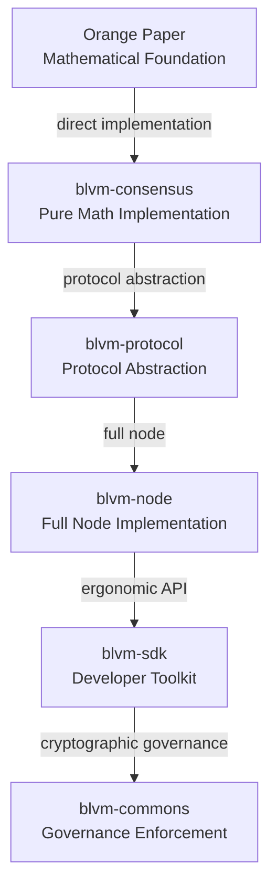

# Stack overview

Bitcoin Commons is a Bitcoin implementation ecosystem built as a **six-layer technology stack** on the [Orange Paper](../reference/orange-paper.md).

**“Layer” here means stack position**, not [governance repository layers](../governance/layer-tier-model.md) or PR **tiers**. **blvm-consensus** and **blvm-protocol** share **blvm-primitives** for types, serialization, and crypto.

The stack implements consensus from the spec, abstracts protocol variants, ships a reference full node, SDK, and governance enforcement tooling.

## Six-layer stack (architecture)

## Component Overview

### Stack layer 1: [Orange Paper](../reference/orange-paper.md) (Mathematical Foundation)
- Mathematical specifications for Bitcoin consensus rules
- Source of truth for all implementations
- Timeless, immutable consensus rules

### Stack layer 2: [blvm-consensus](../consensus/overview.md) (Pure Math Implementation)
- Direct implementation of [Orange Paper](../reference/orange-paper.md) functions
- [Formal proofs](../consensus/formal-verification.md) verify mathematical correctness
- [Property-based testing](../development/property-based-testing.md) checks mathematical invariants
- Side-effect-free, deterministic functions
- Consensus-critical dependencies and transitive pins follow **`Cargo.toml`** (BLVM crates use **published ranges**; many third-party crates use **`=`** where pinned)

### Stack layer 3: [blvm-protocol](../protocol/overview.md) (Protocol Abstraction)
- Bitcoin protocol abstraction for multiple variants
- Supports mainnet, testnet, regtest
- Commons-specific protocol extensions ([UTXO commitments](../node/utxo-commitments.md), ban list sharing)
- BIP implementations (BIP152, BIP157, BIP158, BIP173/350/351)

### Stack layer 4: [blvm-node](../node/overview.md) (Node Implementation)
- Reference full node: non-consensus storage, P2P, RPC, and [module system](../architecture/module-system.md)
- [Multi-transport networking](../node/transport-abstraction.md), [storage backends](../node/storage-backends.md), and [performance](../node/performance.md)

### Stack layer 5: [blvm-sdk](../sdk/overview.md) (Developer Toolkit)
- Governance primitives (key management, signatures, [multisig](../governance/multisig-configuration.md))
- CLI tools (blvm-keygen, blvm-sign, blvm-verify)
- [Composition framework](../architecture/module-system.md) (declarative node composition)
- Bitcoin-compatible signing standards

### Stack layer 6: [blvm-commons](../governance/blvm-commons.md) (Governance Enforcement)
- GitHub App for [governance](../governance/overview.md) enforcement
- Cryptographic signature verification
- Multisig threshold enforcement
- [Audit trails](../governance/audit-trails.md)
- OpenTimestamps integration
- [Forkable governance rules](../governance/governance-fork.md)

## Data Flow

Runtime data flow and crate dependencies: [Component Relationships](component-relationships.md#data-flow).

## Cross-Layer Validation

Dependency rules, crate-graph boundaries, and version coordination: [Component Relationships](component-relationships.md#cross-layer-validation).

## Source repositories

| Stack layer | Crate | Repository |
|-------------|-------|------------|
| 2 | blvm-consensus | [BTCDecoded/blvm-consensus](https://github.com/BTCDecoded/blvm-consensus) |
| 3 | blvm-protocol | [BTCDecoded/blvm-protocol](https://github.com/BTCDecoded/blvm-protocol) |
| 4 | blvm-node | [BTCDecoded/blvm-node](https://github.com/BTCDecoded/blvm-node) |
| 5 | blvm-sdk | [BTCDecoded/blvm-sdk](https://github.com/BTCDecoded/blvm-sdk) |
| 6 | blvm-commons | [BTCDecoded/blvm-commons](https://github.com/BTCDecoded/blvm-commons) |
| Umbrella binary | blvm | [BTCDecoded/blvm](https://github.com/BTCDecoded/blvm) |

## See Also

- [Design Philosophy](design-philosophy.md) — why the stack is split this way

