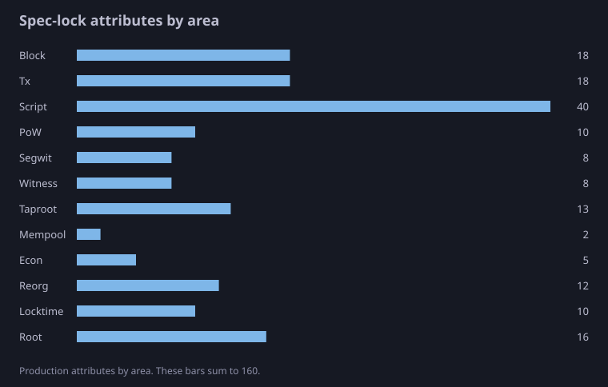
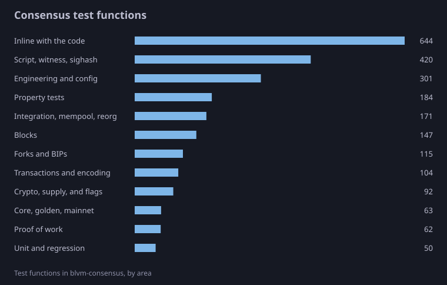

# Assurance

Consensus coverage runs from an Orange Paper sentence to a mainnet block. The figures are the locks. The rows say what a pass means.

Z3 checks 281 `#[spec_locked]` functions, including witness fixtures. Thirteen functions are proved from the body. The mutation gate holds for 93 functions in the written guide and for all 34 in the tool's list. `blvm-consensus` has 2,353 test functions, 187 of them property tests, and 63 fuzz harnesses. Sixteen Orange Paper sentences are Lean proofs. Theorem 6.1.2, the subsidy rule, is proved in Lean for every natural number and in Rust for the heights the tool checks.

## Where the attributes sit

The bars are the production `#[spec_locked]` attributes in `blvm-consensus`, counted 2026-11-14. Witness fixtures bring the total to 281.

## Where the tests sit

Counted 2026-11-18 from `#[test]` and `#[tokio::test]`. The property tests include the Orange Paper property file, which compares results with the Orange Paper formulas. Sixty-three fuzz harnesses run beside this count.

## Specification

| Check | A pass locks | List |
|-------|----------------|------|
| Orange Paper | The sentence is the rule the other rows refer to | [sentence-inventory.tsv](https://github.com/BTCDecoded/blvm-spec-lock/blob/main/docs/sentence-inventory.tsv): 275 sentences |

## Formal verification of the Rust

| Check | A pass locks | List |
|-------|----------------|------|
| `#[spec_locked]` | The function carries an Orange Paper contract | `cargo spec-lock coverage --format json`, field `by_section`. Section map: [SPEC_LOCK_COVERAGE.md](https://github.com/BTCDecoded/blvm-spec-lock/blob/main/SPEC_LOCK_COVERAGE.md). The consensus count with witness fixtures is 281 |
| `check-drift` | Those contracts still parse against the spec | The drift report from the command in [Formal verification](formal-verification.md) |
| Spec lock, Z3 | Z3 discharged the contract. A **Passed** row is formal verification of that function | `cargo spec-lock verify` JSON, one row per function |
| Body proofs | The proof is tied to the function body | 13 functions, named in [VERIFICATION.md](https://github.com/BTCDecoded/blvm-consensus/blob/main/docs/VERIFICATION.md): `sigop_count_push_opcode`, `is_pay_to_script_hash`, `validate_supply_limit`, `is_witness_empty`, `is_witness_version_opcode`, `validate_taproot_script`, `validate_segwit_witness_structure`, `tx_has_nonempty_input_witness`, `script_bool_bytes`, `is_version_zero_witness_program`, `validate_taproot_script_path_with_leaf_version`, `locktime_types_match`, `tx_requires_witness_script_flags` |
| Mutation gate | A semantic edit makes Z3 report that the obligation no longer holds | 93 functions in that same guide. The tool's list is 34 of 34 in [MUTATION_COVERAGE.md](https://github.com/BTCDecoded/blvm-spec-lock/blob/main/docs/MUTATION_COVERAGE.md) |

## Formal verification of the spec model

| Check | A pass locks | List |
|-------|----------------|------|
| Lean | Sixteen sentences are theorems of the model in `blvm-spec/lean/`. The subsidy theorem (6.1.2) is proved in Lean for every natural number, and in Rust for the heights the tool checks | [sentence-inventory.tsv](https://github.com/BTCDecoded/blvm-spec-lock/blob/main/docs/sentence-inventory.tsv) |

## Tests in the crate

| Check | A pass locks | List |
|-------|----------------|------|
| Unit tests | The asserted case holds | `cargo test` in `blvm-consensus` |
| Property tests | The invariant holds on the generated inputs | [property-based testing](../development/property-based-testing.md), `tests/consensus_property_tests.rs` |
| Fuzz | The harness accepts the corpus and the generated inputs it has run | `[[bin]]` names in [blvm-consensus/fuzz/Cargo.toml](https://github.com/BTCDecoded/blvm-consensus/blob/main/fuzz/Cargo.toml): transaction and block validation, script, proof of work, subsidy, serialization, sighash, ECDSA and Schnorr, locktime, sigops, witness, taproot, BIP 34, 54, 66, 90, 113, 119, and 147, plus `offchain_class` |
| MIRI | The selected tests run without undefined behavior | [Testing](../development/testing.md#miri-integration) |
| Internal differential fuzz | A serialize/deserialize round-trip inside this crate agrees with itself | `differential_fuzzing` in the same `fuzz/Cargo.toml` |

## Tests against Bitcoin Core

| Check | A pass locks | List |
|-------|----------------|------|
| Core transaction vectors | BLVM accepts `tx_valid.json` and rejects `tx_invalid.json` | [core_test_vectors/README.md](https://github.com/BTCDecoded/blvm-consensus/blob/main/tests/core_test_vectors/README.md), run from `transaction_tests.rs` |
| Activation-height scripts | The script verdict matches `libbitcoinconsensus` at the height before, on, and after each activation | [height_script_differential.rs](https://github.com/BTCDecoded/blvm-consensus/blob/main/tests/height_script_differential.rs) |
| Per-input script bench | The script verdict matches `libbitcoinconsensus` when the prevout is known | `blvm-bench` `script_validation.rs` |
| Regtest BIP comparison | Accept and reject match a Core node over RPC for BIP30, BIP34, BIP90, and a valid block | [Differential testing](../development/differential-testing.md), `blvm-bench` `tests/integration.rs` |
| Historical replay | BLVM's result matches Core on the mainnet blocks in the chosen height range | `test_historical_blocks_differential` |
| Full-chain phase 1 | BLVM accepts every non-coinbase script on the canonical mainnet chain Core already accepted | [FULL_CHAIN_DIFFERENTIAL.md](https://github.com/BTCDecoded/blvm-bench/blob/main/docs/FULL_CHAIN_DIFFERENTIAL.md), `sort_merge_test` step 6 |
| Full-chain phase 2 | `connect_block` matches `libbitcoinkernel` `process_block` on block connection | The same note, `block_kernel_diff` |

Phase 1 is the script comparison. Phase 2 is the block-connection comparison. The records are on the [differential testing](../development/differential-testing.md) page.

## What runs them

Consensus CI runs `cargo test --all-features`, then `check-drift`, then `verify`. The workflow is [blvm-consensus CI](https://github.com/BTCDecoded/blvm-consensus/blob/main/.github/workflows/ci.yml). Commands and the Z3 timeout are on [Formal verification](formal-verification.md).
