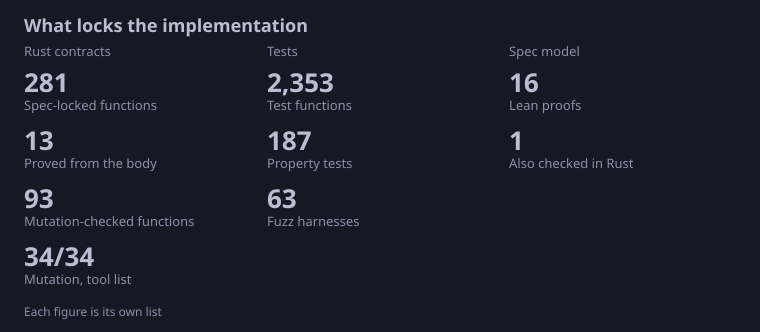

# Assurance

Consensus coverage runs from an Orange Paper sentence to a mainnet block. The figures are the locks. The rows say what a pass means.

Z3 checks the `#[spec_locked]` functions on the figure, including witness fixtures. The other rows are the body proofs, the mutation checks, the test functions, and the Lean proofs. Theorem 6.1.2, the subsidy rule, is proved in Lean for every natural number and in Rust for the heights the tool checks.

## Where the attributes sit

The bars are the production `#[spec_locked]` attributes in `blvm-consensus`. Witness fixtures are included in the figure's total.

## Where the tests sit

Counted from `#[test]` and `#[tokio::test]`. The property tests include the Orange Paper property file, which compares results with the Orange Paper formulas. The fuzz harnesses on the first figure run beside this count.

## Specification

<section>

Orange Paper

The sentence is the rule the other rows refer to.

<a href="https://github.com/BTCDecoded/blvm-spec-lock/blob/main/docs/sentence-inventory.tsv">sentence-inventory.tsv</a>.

</section>

## Formal verification of the Rust

<section>

<code>#[spec_locked]</code>

The function carries an Orange Paper contract.

<code>cargo spec-lock coverage --format json</code>, field <code>by_section</code>. Section map: <a href="https://github.com/BTCDecoded/blvm-spec-lock/blob/main/SPEC_LOCK_COVERAGE.md">SPEC_LOCK_COVERAGE.md</a>.

</section>
<section>

<code>check-drift</code>

Those contracts still parse against the spec.

The drift report from the command in <a href="formal-verification.html">Formal verification</a>.

</section>
<section>

Spec lock, Z3

Z3 discharged the contract. A <strong>Passed</strong> row is formal verification of that function.

<code>cargo spec-lock verify</code> JSON, one row per function.

</section>
<section>

Body proofs

The proof is tied to the function body. The functions are named in <a href="https://github.com/BTCDecoded/blvm-consensus/blob/main/docs/VERIFICATION.md">VERIFICATION.md</a>.

<ul class="lock-names">
<li><code>sigop_count_push_opcode</code></li>
<li><code>is_pay_to_script_hash</code></li>
<li><code>validate_supply_limit</code></li>
<li><code>is_witness_empty</code></li>
<li><code>is_witness_version_opcode</code></li>
<li><code>validate_taproot_script</code></li>
<li><code>validate_segwit_witness_structure</code></li>
<li><code>tx_has_nonempty_input_witness</code></li>
<li><code>script_bool_bytes</code></li>
<li><code>is_version_zero_witness_program</code></li>
<li><code>validate_taproot_script_path_with_leaf_version</code></li>
<li><code>locktime_types_match</code></li>
<li><code>tx_requires_witness_script_flags</code></li>
</ul>
</section>
<section>

Mutation gate

A semantic edit makes Z3 report that the obligation no longer holds.

The functions in that same guide, and the tool's list in <a href="https://github.com/BTCDecoded/blvm-spec-lock/blob/main/docs/MUTATION_COVERAGE.md">MUTATION_COVERAGE.md</a>.

</section>

## Formal verification of the spec model

<section>

Lean

The theorems of the model in <code>blvm-spec/lean/</code> are marked in the sentence inventory. The subsidy theorem (6.1.2) is proved in Lean for every natural number, and in Rust for the heights the tool checks.

<a href="https://github.com/BTCDecoded/blvm-spec-lock/blob/main/docs/sentence-inventory.tsv">sentence-inventory.tsv</a>.

</section>

## Tests in the crate

<section>

Unit tests

The asserted case holds.

<code>cargo test</code> in <code>blvm-consensus</code>.

</section>
<section>

Property tests

The invariant holds on the generated inputs.

<a href="../development/property-based-testing.html">Property-based testing</a>, <code>tests/consensus_property_tests.rs</code>.

</section>
<section>

Fuzz

The harness accepts the corpus and the generated inputs it has run.

<code>[[bin]]</code> names in <a href="https://github.com/BTCDecoded/blvm-consensus/blob/main/fuzz/Cargo.toml">blvm-consensus/fuzz/Cargo.toml</a>: transaction and block validation, script, proof of work, subsidy, serialization, sighash, ECDSA and Schnorr, locktime, sigops, witness, taproot, BIP 34, 54, 66, 90, 113, 119, and 147, plus <code>offchain_class</code>.

</section>
<section>

MIRI

The selected tests run without undefined behavior.

<a href="../development/testing.html#miri-integration">Testing</a>.

</section>
<section>

Internal differential fuzz

A serialize/deserialize round-trip inside this crate agrees with itself.

<code>differential_fuzzing</code> in the same <code>fuzz/Cargo.toml</code>.

</section>

## Tests against Bitcoin Core

<section>

Core transaction vectors

BLVM accepts <code>tx_valid.json</code> and rejects <code>tx_invalid.json</code>.

<a href="https://github.com/BTCDecoded/blvm-consensus/blob/main/tests/core_test_vectors/README.md">core_test_vectors/README.md</a>, run from <code>transaction_tests.rs</code>.

</section>
<section>

Activation-height scripts

The script verdict matches <code>libbitcoinconsensus</code> at the height before, on, and after each activation.

<a href="https://github.com/BTCDecoded/blvm-consensus/blob/main/tests/height_script_differential.rs">height_script_differential.rs</a>.

</section>
<section>

Per-input script bench

The script verdict matches <code>libbitcoinconsensus</code> when the prevout is known.

<code>blvm-bench</code> <code>script_validation.rs</code>.

</section>
<section>

Regtest BIP comparison

Accept and reject match a Core node over RPC for BIP30, BIP34, BIP90, and a valid block.

<a href="../development/differential-testing.html">Differential testing</a>, <code>blvm-bench</code> <code>tests/integration.rs</code>.

</section>
<section>

Historical replay

BLVM's result matches Core on the mainnet blocks in the chosen height range.

<code>test_historical_blocks_differential</code>.

</section>
<section>

Full-chain phase 1

BLVM accepts every non-coinbase script on the canonical mainnet chain Core already accepted.

<a href="https://github.com/BTCDecoded/blvm-bench/blob/main/docs/FULL_CHAIN_DIFFERENTIAL.md">FULL_CHAIN_DIFFERENTIAL.md</a>, <code>sort_merge_test</code> step 6.

</section>
<section>

Full-chain phase 2

<code>connect_block</code> matches <code>libbitcoinkernel</code> <code>process_block</code> on block connection.

The same note, <code>block_kernel_diff</code>.

</section>

Phase 1 is the script comparison. Phase 2 is the block-connection comparison. The records are on the [differential testing](../development/differential-testing.md) page.

## What runs them

Consensus CI runs `cargo test --all-features`, then `check-drift`, then `verify`. The workflow is [blvm-consensus CI](https://github.com/BTCDecoded/blvm-consensus/blob/main/.github/workflows/ci.yml). Commands and the Z3 timeout are on [Formal verification](formal-verification.md).
