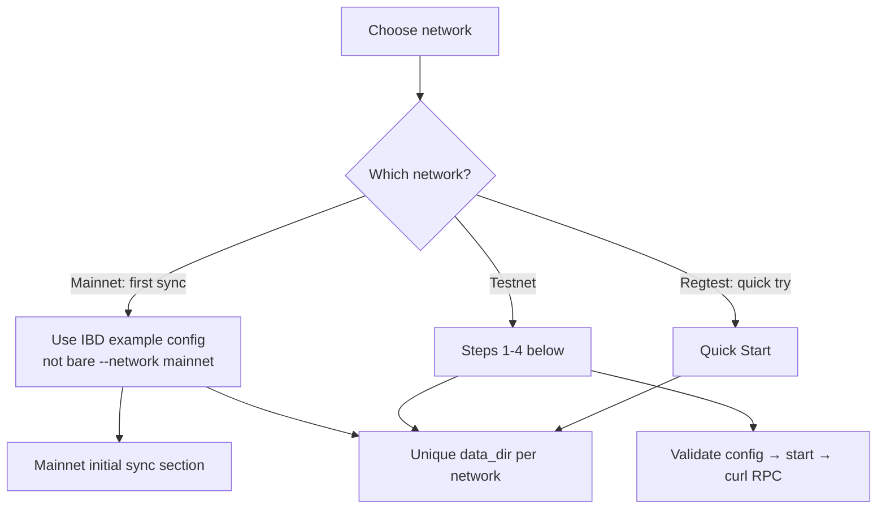

# First Node Setup

Config-file walkthrough: create `~/.config/blvm/blvm.toml`, validate it, start the node, and confirm RPC. For a five-minute regtest tutorial, use [Quick Start](quick-start.md) instead.

The operator binary is `blvm`. It does not hold keys. Wallet RPCs are absent. `getdescriptorinfo` and `analyzepsbt` are the miniscript override. Signing stays out.

`blvm-node` is pre-production for mainnet. A release checksum is a SHA256 file, not a signature.

---

## Choose a network

| Network | `protocol_version` | Default P2P | Default RPC | Next step |
|---------|---------------------|-------------|-------------|-----------|
| **Mainnet** | `BitcoinV1` | `0.0.0.0:8333` | `127.0.0.1:8332` | [Mainnet initial sync](#mainnet-initial-sync) below |
| **Testnet** | `Testnet3` | `0.0.0.0:18333` | `127.0.0.1:18332` | Steps 1-4 below |
| **Regtest** | `Regtest` | `0.0.0.0:18444` | `127.0.0.1:18443` | [Quick Start](quick-start.md) |

Bind addresses and CLI defaults: [Node Configuration](../node/configuration.md#network-defaults-blvm-binary-no-rpc-addr-override). Wire magic bytes and ports: [Protocol variants](../protocol/overview.md#protocol-variants).

Use a **separate `[storage].data_dir` per network** so chain state never mixes.



---

## Step 1: Create configuration directory

```bash
mkdir -p ~/.config/blvm
```

## Step 2: Create `blvm.toml`

Example for **testnet** (`~/.config/blvm/blvm-testnet.toml`) or learning config shape:

```toml
transport_preference = "tcponly"
listen_addr = "0.0.0.0:18333"
protocol_version = "Testnet3"

[storage]
data_dir = "~/.local/share/blvm-testnet"
database_backend = "auto"

[logging]
level = "info"
```

For **mainnet first sync**, skip this minimal template: use the [IBD example config](#mainnet-initial-sync) (`blvm-mainnet-ibd.toml.example`) with pruning and parallel IBD instead.

- **`transport_preference`** is required in TOML (no serde default when loading a file).
- **RPC bind** uses `--rpc-addr` / `BLVM_RPC_ADDR`; the optional **`[rpc]`** table is limits only: see [Node Configuration](../node/configuration.md).
- **Production:** configure `[rpc_auth]` before exposing RPC beyond loopback. See [Deployment posture](../security/deployment-posture.md).

### Step 2b: Validate the file

```bash
blvm config validate ~/.config/blvm/blvm-testnet.toml
```

Expected: **`Configuration file is valid:`** (with the path).

## Step 3: Start the node

```bash
env -u BLVM_ASSUME_VALID_HEIGHT \
 blvm --config ~/.config/blvm/blvm-testnet.toml --verbose
```

Confirm in the first log lines: config loaded, **`Network: …`**, and `Data directory:` matches `[storage].data_dir`.

## Step 4: Verify RPC

Testnet **18332**; regtest **18443**; mainnet **8332**.

With no RPC password, the process writes `{datadir}/.cookie` as `__cookie__:<hex>`, mode `0600`, and deletes that file on stop. A configured password leaves the directory untouched.

```bash
curl -s --user "$(cat ~/.local/share/blvm-testnet/.cookie)" \
 -X POST http://127.0.0.1:18332 \
 -H "Content-Type: application/json" \
 -d '{"jsonrpc":"2.0","method":"getblockchaininfo","params":[],"id":1}'
```

See [RPC API Reference](../node/rpc-api.md) for authentication and the full method list.

---

## Defaults this binary ships

A fresh install enables `blvm-miniscript`, `blvm-zmq`, and `blvm-index`, each at `0.1.*`. `blvm-payment` is not in that set. Payment, vault, pool, and congestion methods return method-not-found until that module is loaded. The IBD example below sets `[modules].enabled = false` for the sync. That example is not the fresh-install default.

`blvm-index` is script history. The node binds Electrum and Esplora. An unset `[services]` `listen` does not open a port.

ZMQ's default binds are loopback:

| Topic | Bind |
|-------|------|
| `hashblock` | `tcp://127.0.0.1:28332` |
| `hashtx` | `tcp://127.0.0.1:28333` |
| `rawblock` | `tcp://127.0.0.1:28334` |
| `rawtx` | `tcp://127.0.0.1:28335` |
| `sequence` | `tcp://127.0.0.1:28336` |

The `sequence` body is 33 bytes: `0x01` for a mempool entry and `0x02` for a removal. It is not Bitcoin Core's `C`/`D`/`R`/`A` frame. The socket is not authenticated.

- The release default storage feature is heed3.
- A second process cannot open the same data directory. Startup rejects a store that fails the block check.
- Compact filters stay off unless configured.
- A named config file that is missing is refused.
- Stratum flags are refused when the binary was built without the stratum feature.
- `blvm-fibre` is not in the module registry until its `module.toml` has a `[downloads]` table.
- The release binary on `origin/main` compiles CUDA kernels and does not link `libcudart`.

REST is compiled into the default binary. It does not listen until `rest_api.enabled` is set. Routes are under `/api/v1`. They are not Bitcoin Core `/rest/*`. Payment REST routes are not served. Fee estimates from `blvm-index` are the node's own paths (`GET /fee-estimates` and `GET /api/fee-estimates`).

`RbfConfig::default` sets `allow_package_replacements` to `true` and `mode` to standard. `min_relay_fee_rate` defaults to `100`, in satoshis per 1,000 virtual bytes. A 67-virtual-byte transaction at that floor pays 7 satoshis. That is 0.1 sat/vB. In standard mode a replacement does not need the original to signal BIP125, as in Core's default; only `mode = "conservative"` requires signaling. The standard-mode bump is the incremental relay fee, not `min_fee_bump_satoshis`.

### Assume-valid

These seeds are this binary's. They are not Bitcoin Core's `defaultAssumeValid`. The Core checkout `f0de87f040` comments mainnet `defaultAssumeValid` as height `966143`. Do not copy that hash onto height `912683`.

| Network | Seeded height | Header hash |
|---------|---------------|-------------|
| mainnet | 912683 | `00000000000000000000611fd22f2df7c8fbd0688745c3a6c3bb5109cc2a12cb` |
| testnet | 4550000 | unset |
| signet | 267665 | unset |
| testnet4 | 0 | no assume-valid section |
| regtest | 0 | no assume-valid section |

When the hash is unset, script checks still run. A CLI disable sets the height to 0 and clears the hash. Fork choice states no maximum reorg depth. Do not copy another node's 1024 or 288.

Mainnet AssumeUTXO data in this tree is an empty list. The node does not publish a mainnet snapshot. Regtest has a test entry at height 100. A matching MuHash is not a snapshot load.

---

## Mainnet initial sync {#mainnet-initial-sync}

After [Installation](installation.md). **Do not** start first mainnet sync with bare `blvm --network mainnet`: use the release **IBD example config** (pruning, `[ibd].mode = "parallel"`, `[modules].enabled = false` during sync). Source: [blvm-mainnet-ibd.toml.example](https://github.com/BTCDecoded/blvm/blob/main/blvm-mainnet-ibd.toml.example).

**From a release directory** (contains `blvm`, `scripts/`, and the example TOML):

```bash
cd /path/to/your/blvm-release
./scripts/start-ibd-mainnet.sh
```

Seed `~/.config/blvm/blvm.toml` from the example: `./scripts/start-ibd-mainnet.sh --init-config`, edit peers if you have LAN Core, then run again.

**With `blvm` on PATH only:**

```bash
blvm --config /path/to/blvm-mainnet-ibd.toml.example \
 --network mainnet \
 --data-dir ~/.local/share/blvm-mainnet \
 --verbose
```

**What you should see:** config loads → `Network: Mainnet` → quiet 15-60s (peer discovery) → `IBD: <height> / <tip>` in logs. Plan for **~15 GB+** pruned disk, **hours** on WAN-only (faster with LAN Core). Pruning limits what stays on disk, not what is downloaded: a pruned node still fetches and validates every block from genesis, about 690–740 GB of one-time IBD transfer as of mid-2026, the same as an archival node, which stores about 700–750 GB ([Full Cost of Running a Bitcoin Node](https://secsov.com/articles/full-cost-of-running-a-bitcoin-node/), v2.4, July 2026). Validation slows when the seeded assume-valid height (`912683`) ends: expected.

**Monitor** (match start flags):

```bash
blvm --network mainnet \
 --config ~/.config/blvm/blvm.toml \
 --data-dir ~/.local/share/blvm-mainnet \
 sync
```

**Resume:** reuse the same `--data-dir`; never delete the active backend dir (`heed3/`, `rocksdb/`, …) mid-IBD.

**Tune when needed:** `BLVM_IBD_PEERS`, `BLVM_IBD_MODE`, `BLVM_IBD_WAN_SINGLE_PEER=1`, `BLVM_IBD_ENGINE=0` to opt out of the UTXO engine. See [Node configuration: IBD](../node/configuration.md#ibd-configuration), [IBD UTXO engine](../node/ibd-engine.md), [Troubleshooting: Mainnet IBD](../appendices/troubleshooting.md#mainnet-ibd).

---

## Other network examples

### Regtest (local dev)

```toml
transport_preference = "tcponly"
listen_addr = "127.0.0.1:18445" # default P2P is 18444
protocol_version = "Regtest"

[storage]
data_dir = "~/.local/share/blvm-regtest"
database_backend = "auto"

[rpc_auth]
admin_tokens = ["dev"]
```

No public seeds: see [Quick Start](quick-start.md) for `generatetoaddress`.

---

## Storage

Blocks, UTXO set, chain state, and indexes live under `[storage].data_dir`. See [Storage Backends](../node/storage-backends.md).

## Peers and sync

- **Mainnet / testnet:** DNS seeds and addr relay.
- **Regtest:** only configured peers; height stays at genesis until you add one.

## See also

- [Configuration Reference](../reference/configuration-reference.md)
- [Node Operations](../node/operations.md): backup, Core datadir import
- [Deployment posture](../security/deployment-posture.md): before exposing mainnet RPC
