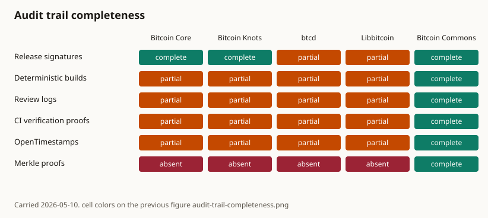

# Audit Trails

Bitcoin Commons maintains immutable audit trails of all governance decisions using cryptographic hash chains and Bitcoin blockchain anchoring.

## Audit Log System

The governance system maintains tamper-evident audit logs that record:

- **All Governance Decisions**: Every PR merge and maintainer signature milestone
- **Maintainer Actions**: Key generation, rotation, and usage
- **Emergency Activations**: Emergency mode activations and deactivations

## Cryptographic Properties

- **Hash Chains**: Each log entry includes hash of previous entry
- **Bitcoin Anchoring**: Monthly registry anchoring via OpenTimestamps
- **Immutable**: Logs cannot be modified without detection
- **Verifiable**: Anyone can verify log integrity

## Audit Log Verification

Audit logs can be verified using:

```bash
blvm-commons verify-audit-log --log-path audit.log
```

## Three-Layer Verification Architecture

## See Also

- [Governance Overview](overview.md) - Governance system introduction
- [Governance Model](governance-model.md) - Governance architecture
- [Keyholder Procedures](keyholder-procedures.md) - Maintainer responsibilities
- [OpenTimestamps Integration](opentimestamps-integration.md) - OTS anchoring details
- [Multisig Configuration](multisig-configuration.md) - Signature requirements

The governance system implements three complementary verification layers:

{{#include ../../charts/fragments/verification-anchors.md}}

The rules are published and are not enforced. The keys in the governance repository are test keys, and merges are not blocked by a second reviewer. The Nostr hour and the monthly OpenTimestamps anchor are the schedules on those integration pages.

## Audit Trail Completeness



Each cell is the color on the previous figure: complete, partial, or absent. `security-control-status.yml` is not the source.

## OpenTimestamps Integration

The system uses OpenTimestamps to anchor audit logs to the Bitcoin blockchain:

- **Monthly Anchoring**: Registry state anchored monthly
- **Immutable Proof**: Proof of existence at specific time
- **Public Verification**: Anyone can verify timestamps

For detailed audit log documentation, see the blvm-commons repository documentation.

