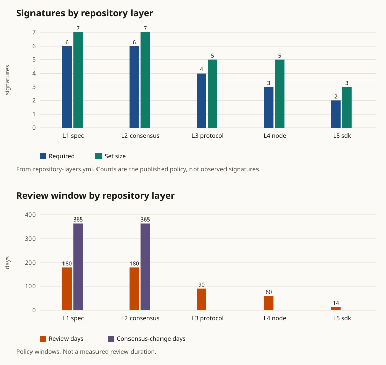
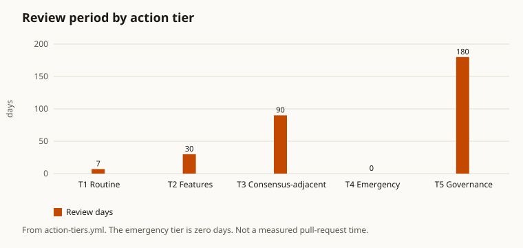
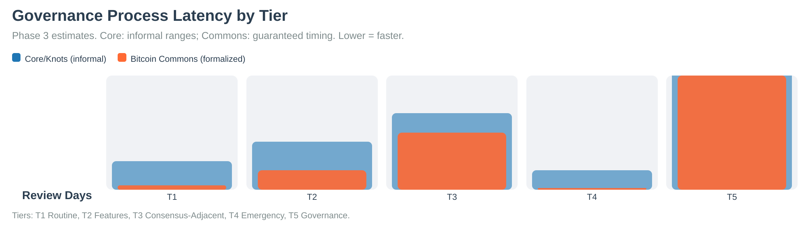
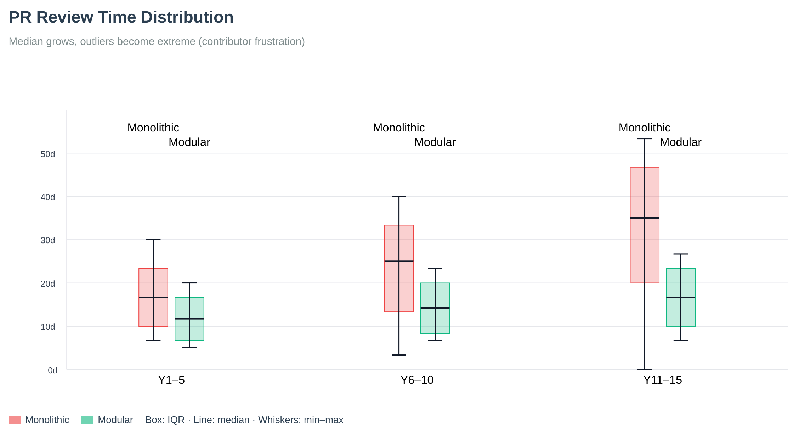

# Governance Model

Bitcoin Commons publishes a constitutional governance model: graduated signature thresholds and review periods.

{{#include ../../modules/governance/GOVERNANCE.md}}

## Governance Signature Thresholds

Required signatures, maintainer set size, and the review window come from `repository-layers.yml` at book build time. Constitutional layers require [[gov:layer_1_signatures]]. Extension layers require [[gov:layer_5_signatures]]. The bars are that policy. They are not a count of signatures collected on a pull request.

## Governance Process Latency

The bar for each action tier is the published review period (`tier_1` through `tier_5` in `action-tiers.yml`). The emergency tier is [[gov:tier_4_review_days]] days. This is the policy window.

The second figure is the previous chart. It draws a Bitcoin Core range beside a Commons range for the same five tiers. Those Core values were not printed as a table, so the picture is carried unchanged.

## Pull request review time

Monolith and modular review-time boxes from the previous figure. The category axis was not printed, so the picture is carried unchanged.

## See Also

### Operator quick answers (FAQ)

- [Do I need governance to run a node?](../appendices/faq.md#do-i-need-governance-to-run-a-node)
- [What is Bitcoin Commons vs BLVM?](../appendices/faq.md#what-is-bitcoin-commons-vs-blvm)
- [What are layers, tiers, and signatures?](../appendices/faq.md#what-are-layers-tiers-and-signatures)
- [Why graduated signature thresholds?](../appendices/faq.md#why-graduated-signature-thresholds)
- [Is the system production ready?](../appendices/faq.md#is-the-system-production-ready) (governance is not universally activated)

### Governance docs

- [PR Process](../development/pr-process.md) - How governance applies to pull requests
- [Layer-Tier Model](layer-tier-model.md) - Layer and tier combination rules
- [Multisig Configuration](multisig-configuration.md) - Signature threshold configuration
- [Governance Overview](overview.md) - Governance system introduction
- [Keyholder Procedures](keyholder-procedures.md) - Maintainer responsibilities
