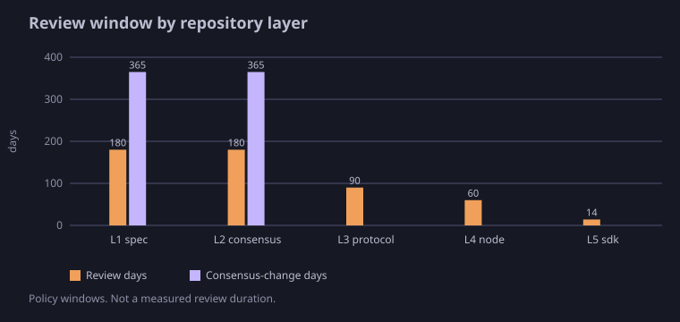
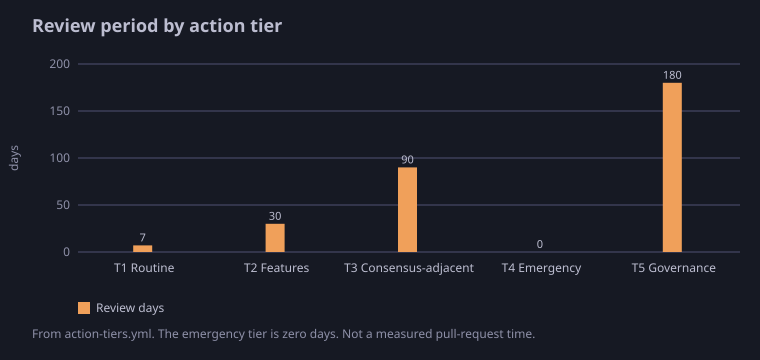

# Governance Model

The rules are published. Enforcement is off. The keys are test keys. A signature does not block a merge.

A change has a repository layer and an action tier. When both apply, the higher signature count and the longer review window win. The matrix is on [Layers and tiers](layer-tier-model.md).

## Signature thresholds by layer

{{#include ../../charts/fragments/layer-signatures.md}}

Required signatures and maintainer set size come from `repository-layers.yml`. Constitutional layers require [[gov:layer_1_signatures]]. Extension layers require [[gov:layer_5_signatures]]. The table is that policy. It is not a count of signatures collected on a pull request.

## Review window by repository layer

Review days and the consensus-change window come from `repository-layers.yml`. The bars are that policy. They are not a measured review duration.

## Review period by action tier

Each bar is the published review period in `action-tiers.yml`. The emergency tier is [[gov:tier_4_review_days]] days. Signature counts for the tiers are on [Layers and tiers](layer-tier-model.md).

Emergency classes, the maintainer roster, and the constitutional text stay in [GOVERNANCE.md](https://github.com/BTCDecoded/governance/blob/main/GOVERNANCE.md).

## See also

- [Layers and tiers](layer-tier-model.md)
- [Multisig configuration](multisig-configuration.md)
- [PR process](../development/pr-process.md)
- [Governance overview](overview.md)
