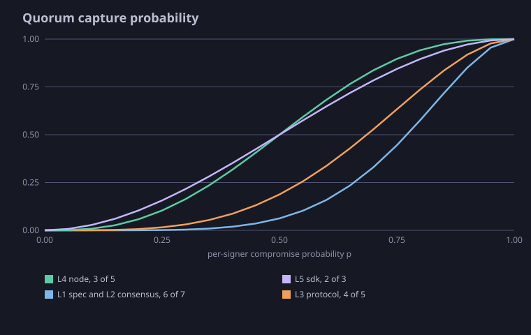
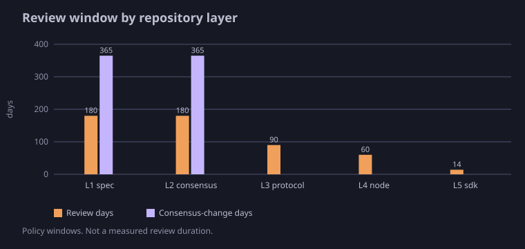
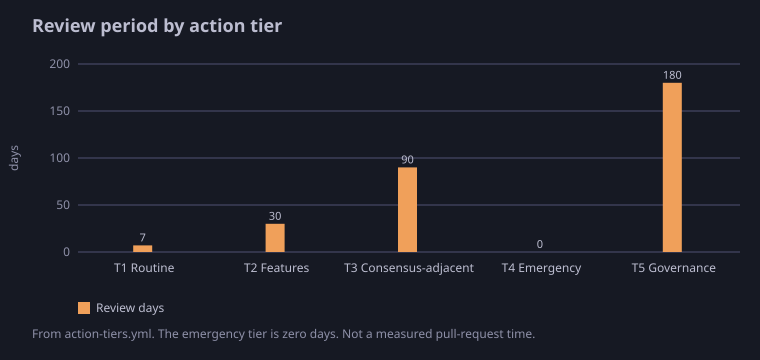

# Multisig Configuration

A layer sets the signature count for the repository. A tier sets the count for the kind of change. When both apply, the higher count and the longer review window win. The matrix is on [Layers and tiers](layer-tier-model.md).

## Quorum capture

The curves use the current *k* and *n* in `repository-layers.yml`. Each signer is compromised independently with probability *p*. The curve is the probability that the number of compromised signers reaches the required count. Layers that share a quorum share a curve. *p* is not a measured attacker rate.

## Thresholds

The layer chart is `repository-layers.yml`. The tier chart is the review window in `action-tiers.yml`. Tier 5 has a second written pair in [GOVERNANCE.md](https://github.com/BTCDecoded/governance/blob/main/GOVERNANCE.md). That pair is not the `tier_5_governance` row alone.

N counts distinct signers. `blvm-sdk` 0.1.23 (29b0eba) and `blvm-commons` (faa7320) count each signer once, so a repeated signature does not satisfy a threshold. Nested multisig for a team or a hierarchy is in the [SDK overview](../sdk/overview.md).

## See also

- [Layers and tiers](layer-tier-model.md)
- [PR process](../development/pr-process.md)
- [Governance model](governance-model.md)
- [Keyholder procedures](keyholder-procedures.md)
