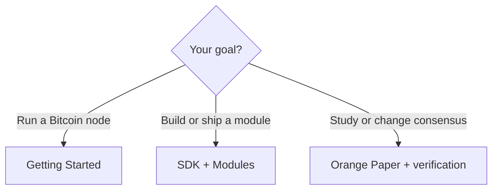

# Introduction

BLVM is a Bitcoin node. The rules are the [Orange Paper](reference/orange-paper.md). `blvm-consensus` implements them. `blvm-protocol` is the wire format for mainnet, testnet, testnet4, signet, and regtest. The program you run is `blvm`.

## Who is this for?

**Running a Bitcoin node?** [Operator guide](getting-started/operator-guide.md) — [Installation](getting-started/installation.md), [Quick Start](getting-started/quick-start.md), [First Node Setup](getting-started/first-node.md) ([mainnet IBD hub](getting-started/operator-guide.md#initial-block-download-ibd)). Read [Deployment posture](security/deployment-posture.md) before exposing RPC on mainnet.

**Building a module or integrating with the SDK?** [Developer guide](getting-started/developer-guide.md) — [Building your first module](getting-started/first-module.md), then [Building modules](sdk/module-development.md).

**Studying the spec or contributing to consensus?** Start with the [Orange Paper](reference/orange-paper.md) and [Formal verification](consensus/formal-verification.md). Contributors: [Repository layout](development/repository-architecture.md), [Contributing](development/contributing.md).

## What is in this book

The Orange Paper is the spec. This manual is what the code does and how to run the node. [Assurance](consensus/assurance.md) is the list of checks on the consensus code.

- **[Orange Paper](reference/orange-paper.md)** is the spec.
- **[blvm-spec-lock](https://github.com/BTCDecoded/blvm-spec-lock)** checks the Rust against that spec. [Formal verification](consensus/formal-verification.md) says what a green run accepts.
- **[blvm-consensus](consensus/overview.md)** is the consensus code.
- **[blvm-protocol](protocol/overview.md)** is the wire format.
- **[blvm-node](node/overview.md)** stores the chain, talks to peers, and serves RPC. Optional pieces are [modules](architecture/module-system.md).
- **[blvm-sdk](sdk/overview.md)** is how you write a module.
- **[Governance](governance/overview.md)** is the published review rules. Enforcement is off.

This manual is the BLVM section of [docs.btcdecoded.org](https://docs.btcdecoded.org/blvm/). The search box is at the top of every page.

## Getting Help

Report bugs or request features via GitHub Issues, ask questions in GitHub Discussions, or report security issues to security@thebitcoincommons.org.
