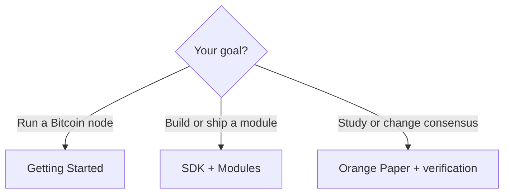
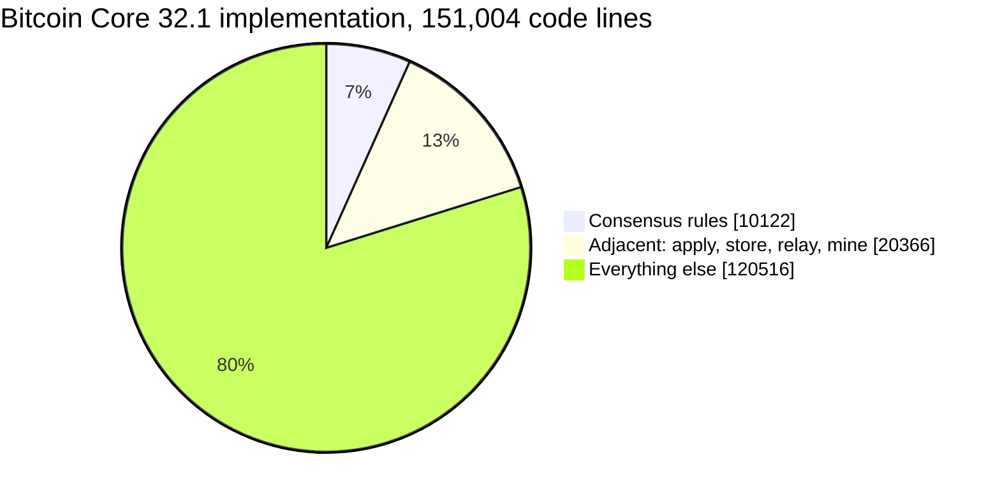

# Introduction

BLVM (Bitcoin Low-Level Virtual Machine) implements Bitcoin consensus from the [Orange Paper](reference/orange-paper.md), provides protocol abstraction for multiple Bitcoin variants, a **reference** full node with P2P networking, a developer SDK, and cryptographic governance for transparent development.

## Who is this for?

**Running a Bitcoin node?** [Operator guide](getting-started/operator-guide.md): [Installation](getting-started/installation.md), [Quick Start](getting-started/quick-start.md), [First Node Setup](getting-started/first-node.md) ([mainnet IBD hub](getting-started/operator-guide.md#initial-block-download-ibd)). Read [Deployment posture](security/deployment-posture.md) before exposing RPC on mainnet.

**Building a module or integrating with the SDK?** [Developer guide](getting-started/developer-guide.md): [Building your first module](getting-started/first-module.md), then [Building modules](sdk/module-development.md).

**Studying the spec or contributing to consensus?** The [Orange Paper](reference/orange-paper.md) is the normative spec. [Formal Verification](consensus/formal-verification.md) explains verification. Contributors: [Repository layout](development/repository-architecture.md), [Contributing](development/contributing.md).

## What is BLVM?

BLVM is compiler-like infrastructure for Bitcoin implementations. The [Orange Paper](reference/orange-paper.md) is the mathematical specification (IR), readable by mathematicians without implementation code. **blvm-consensus** implements those rules; [BLVM Specification Lock](https://github.com/BTCDecoded/blvm-spec-lock) (Z3), differential testing, fuzzing, and tests check the code against the spec. See [compiler-like architecture](reference/glossary.md#compiler-like-architecture), [Formal Verification](consensus/formal-verification.md#what-formal-verification-delivers), and the [six-layer stack](architecture/system-overview.md).

### Why the rules are a separate crate

The consensus rules are a small part of a full node. In Bitcoin Core 32.1 (branch `32.x`, commit `f0de87f`, 26 October 2026, counted with tokei 14.0.0), the implementation is 151,004 code lines. The consensus rules are 10,122 of them, about 7%. Code that applies the rules, stores the result, or chooses what to relay and mine is 20,366, about 13%. The wallet, GUI, RPC, P2P transport, and the rest of the node are 120,516, about 80% ([The Rules Are 7% of the Program](https://secsov.com/articles/the-rules-are-7-percent/)). A wrong rule forks the network; a policy difference does not. That is why BLVM keeps the rules in the Orange Paper and in **blvm-consensus**, apart from the node, the modules, and policy.

Text version of the chart (source: [The Rules Are 7% of the Program](https://secsov.com/articles/the-rules-are-7-percent/), Core 32.1 `f0de87f`, tokei 14.0.0; vendored libraries, tests, and Qt locale files are outside the 151,004):

| Part of the Core 32.1 implementation | Code lines | Share |
|---|---:|---:|
| Consensus rules | 10,122 | 7% |
| Adjacent: apply, store, relay, mine | 20,366 | 13% |
| Everything else: wallet, GUI, RPC, P2P transport, the rest | 120,516 | 80% |

### A specification to build against

Without a written specification, a new implementation has to reverse-engineer the rules from Core's code. The Orange Paper gives implementations a target they can build against instead, in mathematical notation that does not require reading any implementation. The Rust code is written separately and stays the authoritative artifact. [Specification Lock](consensus/formal-verification.md) reads the Rust against the spec's contracts; it does not generate code from the spec, so when a check fails the developer fixes whichever side is wrong. [Differential testing](development/differential-testing.md) runs the implementation against Bitcoin Core; full-chain runs are operator-driven and resource-heavy, and are not a claim that every CI job proves agreement to the chain tip ([Why Bitcoin Needs a Specification That Humans Can Read](https://secsov.com/articles/why-bitcoin-needs-a-specification/)).

**Why "LVM"?** Like LLVM’s shared compiler infrastructure, BLVM provides shared infrastructure for Bitcoin implementations; the Orange Paper is the reference spec; node and consensus code is validated against it.

## Documentation Structure

The sidebar follows three paths from [Who is this for](#who-is-this-for):

- **Operators:** Getting Started → Node → Security
- **Developers:** Getting Started → SDK and modules → Module runtime (under Architecture)
- **Spec and consensus:** Architecture → Consensus → Protocol → Reference (Orange Paper)

Cross-cutting: Governance, Development, Appendices.

Documentation is maintained in source repositories alongside code. This manual is the BLVM section of [docs.btcdecoded.org](https://docs.btcdecoded.org/blvm/). Machine-readable index: [docs llms.txt](https://docs.btcdecoded.org/llms.txt).

## Getting Help

Report bugs or request features via GitHub Issues, ask questions in GitHub Discussions, or report security issues to security@thebitcoincommons.org.
