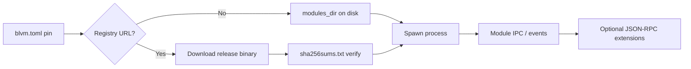

# Module catalog

BLVM node runs optional features as separate, process-isolated modules. See [Building modules](../sdk/module-development.md) to build your own.

## Available modules

Registry status comes from [`registry/modules.json`](https://github.com/BTCDecoded/blvm/blob/main/registry/modules.json) in the `blvm` repository. Each module page repeats it in a **Registry status** line.

**In the registry** (bootstrap via `[modules].registry_url`):

- **blvm-zmq**: ZMQ PUB notifications ([ZMQ module](zmq.md))
- **blvm-index**: script history. Replaces `blvm-wallet-index`. The node binds Electrum and Esplora ([Wallet index](wallet-index.md)).
- **blvm-payment**: payment, vault, pool, and congestion RPC. Not in the default module pins.
- **blvm-miniscript**: Descriptor / PSBT RPC overrides ([Miniscript module](miniscript.md))
- **blvm-governance**: On-chain proposal webhook module ([Governance module](governance-module.md))
- **blvm-marketplace**: Optional registry/payments ([Marketplace module](marketplace-module.md))
- **blvm-fibre**: FIBRE UDP/FEC block relay ([FIBRE module](fibre.md))

**Not in the registry** (build from source; registry bootstrap cannot download these):

- **blvm-lightning**: Lightning payment processing (LNBits, LDK, Stub) ([Lightning Network Module](lightning.md))
- **blvm-mesh**: Payment-gated mesh overlay; four JSON-RPC methods when loaded ([Commons Mesh Module](mesh.md))
- **blvm-stratum-v2**: Stratum V2 mining protocol ([Stratum V2 Module](stratum-v2.md))
- **blvm-datum**: DATUM Gateway (with Stratum V2) ([Datum Module](datum.md))
- **blvm-selective-sync**: IBD sync policy and witness filtering ([Selective Sync Module](selective-sync.md))
- **blvm-miningos**: MiningOS rack integration ([Mining OS Module](miningos.md))

## Module system architecture



Modules run in separate processes with IPC ([Module System Architecture](../architecture/module-system.md)):

- **Process isolation**: Module crash does not take down the node
- **Consensus isolation**: Modules cannot alter consensus rules or the UTXO set
- **Defined APIs**: IPC, ModuleAPI, and optional JSON-RPC extension

## Installing modules

### Registry bootstrap (recommended)

Pin modules in `blvm.toml` under **`[modules]`** (merge into your existing file: a standalone snippet still needs `transport_preference` and network keys elsewhere in the file):

```toml
[modules]
registry_url = "https://raw.githubusercontent.com/BTCDecoded/blvm/main/registry/modules.json"
blvm-zmq = "0.1.*"
blvm-miniscript = "0.1.*"
```

The node downloads version-pinned binaries from GitHub Releases (`sha256sums.txt` on each tag) when a pinned module is missing on disk. See [blvm README](https://github.com/BTCDecoded/blvm/blob/main/README.md) in the `blvm` repository for the full bootstrap contract.

### Build from source

```bash
cargo install blvm-lightning # when published on crates.io
# or clone BTCDecoded/blvm-<name>, cargo build --release, place binary per module.toml
```

### Manual placement

1. Build the module: `cargo build --release`
2. Place the binary and `module.toml` under the node module search path
3. Restart the node or load at runtime via configuration / module manager

## Module configuration

Each module uses `module.toml` plus optional `config.toml`. See per-module pages linked above and [Node configuration](../node/configuration.md).

- **Load** at startup when pinned under **`[modules]`** (inline `blvm-zmq = "0.1.*"`) or loaded at runtime via RPC
- **Unload** without stopping the base node
- **Reload** configuration where the module supports hot reload

## WASM deployment (`wasm-modules`)

WASM is a second way to load a module that already has a `module.toml`, next to the native process. The same capability strings apply. The entry is either the native `entry_point` binary or a file whose name ends in `.wasm`. The feature is off on the default `blvm` binary.

A guest exports `module_name`, `module_version`, `cli_spec`, `dispatch_cli`, `dispatch_rpc`, `event_types`, and `on_event`. `event_types` returns a JSON array of event names. `on_event` receives one JSON event message and returns an empty string or an error string. Fuel resets on each of those calls.

Host imports that already exist stay (`host_log`, KV storage, `host_config_get`). One added import is `host_node_call(method_ptr, method_len, args_ptr, args_len) -> (ptr, len)`, JSON in and JSON out. The methods are `get_block_height` (`read_chain_state`) and `get_block` (`read_blockchain`). The host builds `RequestPayload::GetBlockHeight` or `RequestPayload::GetBlock` and calls `PermissionChecker::check_api_call` with the permission set registered at load. `get_block` args are `{"hash":"<64 hex>"}`. A guest that was not registered, or that was registered without the capability for that call, gets error JSON. The guest does not get a socket import and does not get native `NodeAPI` parity.

CLI spec registration for a loaded guest stays `#[cfg(unix)]`. This feature does not claim Windows while that spec is discarded.

When the node loads a guest, treat it as trusted only if your governance policy says so. The embedder applies **wasmtime fuel** and **store limits** with conservative defaults; override per module via **`[modules.<name>]`** keys in the **[node configuration guide](https://github.com/BTCDecoded/blvm-node/blob/main/docs/CONFIGURATION_GUIDE.md)**.

## See Also

- [Module System Architecture](../architecture/module-system.md)
- [Building modules](../sdk/module-development.md)
- [SDK Overview](../sdk/overview.md)
- [Node Configuration](../node/configuration.md)
