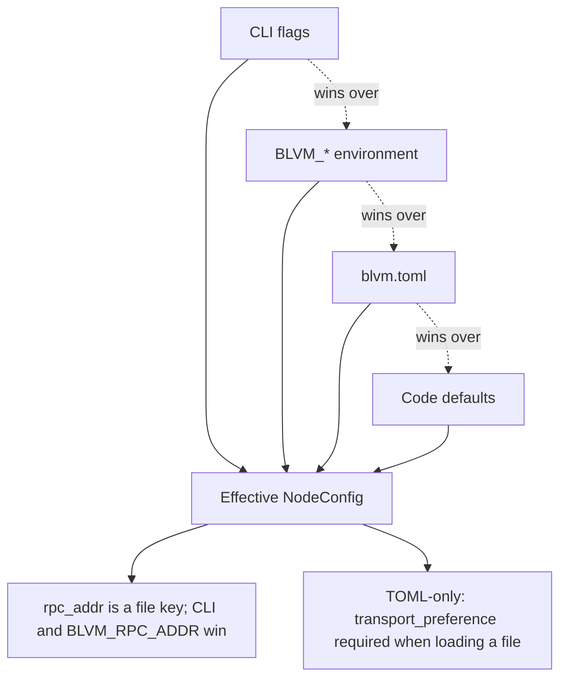

# Node Configuration

BLVM node configuration supports different use cases.

## Protocol Variants

The file names are `mainnet`, `testnet`, `testnet4`, `signet`, and `regtest`. `BitcoinV1` and `Testnet3` are aliases. The binary writes the five names above. With no `--network`, no `BLVM_NETWORK`, and no chain in the file, it uses `regtest`. See [Protocol Variants](../protocol/overview.md#protocol-variants).

## Configuration Precedence

**CLI > ENV > config file > defaults**



The binary applies the CLI, then the environment variables it reads, then the file, then the built-in default. Keys are in the [configuration reference](../reference/configuration-reference.md).

### Network defaults when the address is unset {#network-defaults-blvm-binary-no-rpc-addr-override}

| Network | `protocol_version` | P2P | RPC |
|---------|-------------------|-----|-----|
| Mainnet | `mainnet` | `127.0.0.1:8333` | `127.0.0.1:8332` |
| Testnet | `testnet` | `127.0.0.1:18333` | `127.0.0.1:18332` |
| Testnet4 | `testnet4` | `127.0.0.1:48333` | `127.0.0.1:48332` |
| Signet | `signet` | `127.0.0.1:38333` | `127.0.0.1:38332` |
| Regtest | `regtest` | `127.0.0.1:18444` | `127.0.0.1:18443` |

Separate **`data_dir` per network**. REST bind (when enabled) derives from RPC port: **8080** (mainnet), **18080** (testnet), **28443** (regtest).

## Path Expansion

Config path fields (`storage.data_dir`, `modules.modules_dir`, `ibd.dump_dir`, etc.) support `~` expansion to the home directory when loading from file. Example: `data_dir = "~/.local/share/blvm-mainnet"` resolves to `/home/user/.local/share/blvm-mainnet` on Unix.

## Configuration File

Create a `blvm.toml` configuration file. Keys are **top-level** or in nested tables such as `[storage]`: there is **no** `[network]` wrapper.

`rpc_addr` is the RPC bind. `--rpc-addr` and `BLVM_RPC_ADDR` win over the file. An absent address uses the row above. `[rpc]` holds server limits. Auth is `[rpc_auth]`. The key list is the [configuration reference](../reference/configuration-reference.md).

```toml
listen_addr = "127.0.0.1:8333"
rpc_addr = "127.0.0.1:8332"
# File tags: tcponly, irohonly, quinnonly, hybrid, all.
# BLVM_NODE_TRANSPORT accepts tcponly and tcp_only. There is no transport flag.
transport_preference = "tcponly"
max_peers = 100
protocol_version = "mainnet"
enable_self_advertisement = true

[storage]
data_dir = "/var/lib/blvm"
database_backend = "auto"
```

`NodeConfig` itself leaves `listen_addr`, `rpc_addr`, and `protocol_version` unset. Its transport default is TCP-only, and `max_peers` is 100. The binary fills the chain and the two addresses from the table above.

Configuration is organized in logical sections (`storage`, `ibd`, `modules`, optional `[stratum_v2]`, etc.) in the node codebase. Initial block download uses parallel IBD only.

## Bitcoin Core bitcoin.conf versus BLVM

**BLVM does not read `bitcoin.conf`.** Runtime configuration is **`blvm.toml` / JSON**, **`blvm` CLI**, and **`BLVM_*`** environment variables.

| Bitcoin Core (`bitcoin.conf` or CLI) | BLVM |
|--------------------------------------|------|
| `rpcuser` / `rpcpassword` | **`[rpc_auth].username`** / **`password`** (HTTP Basic; password auto-granted admin), or **`tokens`** / **`admin_tokens`** with **`Authorization: Bearer …`** |
| `rpcbind` / `rpcport` | `rpc_addr`, or `--rpc-addr` / `BLVM_RPC_ADDR` |
| `port` (P2P) | **`listen_addr`** (top-level TOML) or **`--listen-addr`** |
| `addnode=` | **`persistent_peers`** or the **`addnode`** RPC after startup |

To **draft** a `blvm.toml` from a Core config file, use **`blvm config convert-core <path/to/bitcoin.conf>`** (or the **`convert-bitcoin-core-config`** shell/Rust tools in the **`blvm-node`** repo). **Review and normalize** the output: remove legacy **`[network]`** wrappers and nested **`[transport_preference]`** blobs. **`[rpc_auth].username`** / **`password`** are valid for HTTP Basic (map from Core **`rpcuser`** / **`rpcpassword`**), or use **`tokens`** / **`admin_tokens`** for Bearer auth: see the [blvm-node Integration Guide: Migrating from bitcoin.conf](https://github.com/BTCDecoded/blvm-node/blob/main/docs/INTEGRATION_GUIDE.md#migrating-from-bitcoinconf). Set `rpc_addr` or `--rpc-addr`, and set `storage.data_dir` separately.

## IBD Configuration

Default **`mode = "parallel"`**. LAN peers are auto-preferred for download. On WAN-only sync, **`parallel` mode uses multi-peer work-stealing**; set **`BLVM_IBD_WAN_SINGLE_PEER=1`** to force a single download peer. Overrides: **`BLVM_IBD_PEERS`**, **`BLVM_IBD_MODE`**. The UTXO engine is the only IBD UTXO path. First sync: [First Node Setup: Mainnet IBD](../getting-started/first-node.md#mainnet-initial-sync). Engine details: [IBD UTXO engine](ibd-engine.md).

```toml
[ibd]
chunk_size = 128
max_blocks_in_transit_per_peer = 128
download_timeout_secs = 30
mode = "parallel"
eviction = "fifo"
headers_timeout_secs = 30
headers_max_failures = 10
```

`BLVM_IBD_*` overrides the same fields. The key list is [`[ibd]`](../reference/configuration-reference.md#ibd).

## Protocol Limits

Tune P2P message limits for constrained networks:

```toml
[protocol_limits]
max_protocol_message_length = 33554432 # 32 MB default
max_addr_to_send = 1000
max_inv_sz = 50000
max_headers_results = 2000
```

## Environment Variables

The environment sits between the CLI and the file. `BLVM_NETWORK`, `BLVM_DATA_DIR`, `BLVM_LISTEN_ADDR`, and `BLVM_RPC_ADDR` are the addresses and the chain. The other `BLVM_*` names override the field of the same meaning. The fields are in the [configuration reference](../reference/configuration-reference.md).

## Command Line Options

**Precedence:** CLI > ENV > config file > defaults

### Global Options

| Option | Short | Default | Description |
|--------|-------|---------|-------------|
| `--network` | `-n` | `regtest` | `mainnet`, `testnet`, `testnet4`, `signet`, `regtest` |
| `--rpc-addr` | `-r` | network-aware when omitted | RPC bind: mainnet `127.0.0.1:8332`; testnet `127.0.0.1:18332`; testnet4 `127.0.0.1:48332`; signet `127.0.0.1:38332`; regtest `127.0.0.1:18443` |
| `--listen-addr` | `-l` | network-aware when omitted | P2P listen. Unset uses `127.0.0.1` and the port in the table above. |
| `--data-dir` | `-d` | unset | Data directory (overrides ENV and config) |
| `--config` | `-c` | unset | Configuration file path (TOML or JSON) |
| `--verbose` | `-v` | false | Enable verbose logging |
| `--no-auto-migrate` | | false | Do not auto-migrate from a Bitcoin Core datadir on start (requires `rocksdb`) |
| `--migrate-destination` | | unset | BLVM store path when auto-migrating from Core (default: `<datadir>/blvm`) |
| `--migrate-core-only` | | false | Migrate from Core datadir and exit (no P2P/RPC start; requires `rocksdb`) |

### Feature Flags

`--enable-stratum-v2`, `--enable-dandelion`, `--enable-sigop` and corresponding `--disable-*` flags (each requires that **compile-time** feature in the binary).

**BIP158:** `--enable-bip158` / `--disable-bip158` adjust **logged** preference only, compact block filter code is compiled without a separate `bip158` Cargo feature (present in typical `blvm` / `blvm-node` builds).

**REST API:** enable in `blvm.toml` with **`[rest_api].enabled = true`** (requires **`rest-api`** in the binary). Binds a separate loopback port (default **8080** when RPC is **8332**, **18080** when RPC is **18332**, otherwise RPC port **+ 10000**: e.g. **28443** for regtest **18443**). See [RPC API: REST](rpc-api.md#rest-api).

### Advanced Options

`--assumevalid` with 64 hex digits sets the assume-valid hash and keeps the seeded height. `--noassumevalid` and `--assumevalid 0` clear the height and the hash. With no `[block_validation]` table, mainnet seeds height **912683** and the checked header hash. Testnet and signet seed a height and leave the hash unset. Also: `--assumeutxo`, `--target-peer-count`, `--async-request-timeout`, `--module-max-cpu-percent`, `--module-max-memory-bytes`.

### Commands

`start` (default), `status`, `health`, `version`, `chain`, `peers`, `network`, `sync`, `config show|validate|path|set|convert-core`, `configpath <module>` (offline module config path), `load` / `unload` / `reload` / `module list` (admin RPC to a running node), `migrate core` (requires `rocksdb`), `rpc`, plus dynamic module CLI (e.g. `blvm sync-policy list` when selective-sync is loaded). Remote subcommands use **`[rpc_auth]` from the same `--config`** as the node (admin Bearer token or Basic password).

```bash
blvm --network mainnet -d /var/lib/blvm
blvm migrate core --source ~/.bitcoin --destination ~/.bitcoin/blvm --network mainnet --verify
blvm start --data-dir ~/.bitcoin --migrate-core-only # migrate only, then exit
blvm config show
blvm status --rpc-addr 127.0.0.1:8332
```

## Bitcoin Core drop-in

BLVM does not read Core chainstate in place. With **`rocksdb`**, a synced Core **`--data-dir`** triggers one-time migration into **`<datadir>/blvm/`** unless disabled. After migrate, point **`--data-dir`** at the BLVM store or keep the Core path (node opens `blvm/` when marked).

**Default behavior:** migrate UTXOs and indexes only; **do not copy** Core **`blocks/`** (~700 GB on mainnet). BLVM reads block bodies from the original Core **`blocks/`** directory via a fallback reader. Set **`storage.reuse_core_block_files = false`** (or **`BLVM_REUSE_CORE_BLOCK_FILES=0`**) only if you want a self-contained BLVM store that duplicates block files.

| Mechanism | Purpose |
|-----------|---------|
| `--data-dir` / `BLVM_DATA_DIR` | Core path for detect/migrate, or BLVM store after migrate |
| `--no-auto-migrate` | Skip auto-import |
| `--migrate-destination` | Override `<datadir>/blvm` |
| `--migrate-core-only` | Migrate and exit |
| `blvm migrate core` | Explicit import (`--verify` optional) |

```toml
[storage]
auto_migrate_core = true
# core_migrate_destination = "/var/lib/blvm-mainnet"
# reuse_core_block_files = true # default; set false to copy block bodies into BLVM store
```

ENV and reference: [Configuration Reference](../reference/configuration-reference.md) (`storage.auto_migrate_core`, `storage.reuse_core_block_files`, `BLVM_*`). Operator flow: [Operations](operations.md#starting-from-a-bitcoin-core-datadir). Storage details: [Storage Backends](storage-backends.md#bitcoin-core-drop-in-migrate-on-start). Map Core **`datadir=`** via **`blvm config convert-core`**: see [bitcoin.conf vs BLVM](#bitcoin-core-bitcoinconf-versus-blvm).

## Storage Backends

`database_backend = "auto"` selects heed3 when that feature is compiled in, then RocksDB, Redb, and Sled. Naming `heed3`, `rocksdb`, `redb`, or `sled` forces that backend, and the binary has to be built with the feature. Release builds compile heed3. How a backend behaves is on [Storage Backends](storage-backends.md). Cache, indexing, and pruning keys are [`[storage]`](../reference/configuration-reference.md#storage).

The pruning default is aggressive and expects UTXO commitments. Set `mode = "normal"` or `mode = "disabled"` unless the `utxo-commitments` feature is in the binary. `keep_blocks` is the trailing window (default 288). Pruning stops the node from serving the blocks it deleted.

## Network Configuration

### Transport Options

Configure transport selection at the **top level** of `blvm.toml` (see [Transport Abstraction](transport-abstraction.md)):

```toml
# File (TOML): serde tags: tcponly | irohonly | quinnonly | hybrid | all
transport_preference = "tcponly"
```

**Mapping (CLI / ENV vs config file)**:
- **TOML/JSON** on `NodeConfig`: lowercase enum tags as above (`tcponly`, …).
- **`BLVM_NODE_TRANSPORT`:** the TOML tags, plus `tcp` / `tcp_only`, `iroh` / `iroh_only`, and `quinn` / `quinn_only`. There is no transport command-line flag.

**Available Transport Options**:
- **TCP-only** (`tcponly` in file): default, Bitcoin P2P compatible
- **Iroh-only** (`irohonly`): requires `iroh` feature
- **Quinn-only** (`quinnonly`): requires `quinn` feature
- **Hybrid** (`hybrid`): TCP + Iroh; requires `iroh` feature
- **All** (`all`): requires both `quinn` and `iroh` features

**Feature Requirements**:
- `iroh` feature: Enables Iroh QUIC transport with NAT traversal
- `quinn` feature: Enables standalone Quinn QUIC transport

## RBF Configuration

`[rbf].mode` is `disabled`, `conservative`, `standard`, or `aggressive`. `standard` is the default. The fee, confirmation, and cooldown keys are [`[mempool]` and `[rbf]`](../reference/configuration-reference.md#mempool-and-rbf). What each mode admits is [RBF and Mempool Policies](rbf-mempool-policies.md).

## Advanced Indexing

Address and value indexes are [`[storage.indexing]`](../reference/configuration-reference.md#storage).

## Module Configuration

There is no hardcoded default module list. Copy pins from `blvm.toml.example`, or leave the pin map empty to load modules already on disk under `modules_dir`. A pin is a key under `[modules]`. A module that needs spawn overrides puts `version` in `[modules.<name>]`. Resource limits are `[module_resource_limits]`, not `[modules.resource_limits]`. The keys are [RPC, ban list, governance, modules](../reference/configuration-reference.md#rpc-ban-list-governance-modules). Bootstrap is the [Module System](../architecture/module-system.md). ZMQ topic endpoints are the [ZMQ module](../modules/zmq.md).

## See Also

- [Node Overview](overview.md) — node features and architecture
- [Network Protocol](../protocol/network-protocol.md) — protocol variants
- [Getting Started](../getting-started/installation.md) — installation
- [Troubleshooting](../appendices/troubleshooting.md) — configuration failures

